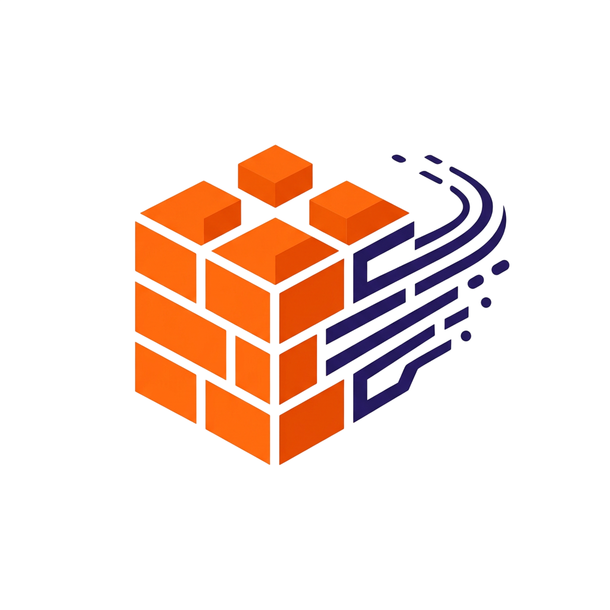

# gobuild-api


   

> **Lightweight and lightning-fast API for automating operational inventory control at construction sites.**

---

> 👀 **For whom**
> 
> Specially built for **construction site supervisors** (powering mobile apps) and **project managers** (feeding web dashboards).

> 💢 **The Problem**
> 
> Paper notebooks and messy Excel sheets still dominate construction sites. Foremen waste **up to 40% of their time** searching for information, while management only finds out about a cement shortage when the work has already ground to a halt.

> ✅ **The Solution**
> 
> A **Go-based microservice** that acts as the real-time "brain" for your construction apps. 
> 1. The foreman presses a single button on their phone.
> 2. The API instantly recalculates the warehouse balance.
> 3. If materials run low, the API automatically triggers an alert: *"Time to reorder"*. **Done!**

---

## 🛠️ Technical Details & Stack

* **Language**: `Go` — chosen for maximum execution speed, minimal memory footprint, and native concurrency support via *goroutines*.
* **Router**: `chi` — a lightweight, idiomatic router fully compatible with the standard library, free of unnecessary bloat.
* **Database**: `SQLite` (optimized for the MVP stage) with a clear path for seamless migration to `PostgreSQL`. Ensures strict ACID transactions, meaning your data remains safe even if the server crashes.
* **Documentation**: `Swagger` (OpenAPI 3.0) — fully interactive and ready to test out of the box.

---

## ⭐ Core Features

### 📦 Nomenclature Management
* **Smart Catalog**: Easily create and manage building materials with names, units of measurement, and defined critical minimum balances.

### 🔄 Material Movement & Transactions
* **Arrival Registration**: Fast logging of new deliveries straight from the supplier or driver.
* **Expense Recording**: Immediate deduction of materials tied to specific construction objects or tasks.
* **Foolproof Mechanism**: The system strictly blocks any attempts to write off more materials than are currently available in stock.

### 📊 Real-Time Analytics
* **Instant Dashboard**: An optimized endpoint that aggregates and returns the current state of your warehouse in milliseconds.
* **Trigger Notifications**: The `GET /api/v1/alerts` endpoint automatically scans the database to return low-stock items, ready to be exported as a purchase order.

## 🚀 How to Launch

To spin up the API server locally, ensure you have Go installed and run the following command in your terminal:

```bash
go run cmd/api/main.go
```

---

## 📈 Project Status

* **Current Status**: 🚧 *CRUD completed, moving to documentation*
* **Version**: `0.4.0-alpha`

*This repository represents an MVP (Minimum Viable Product).

